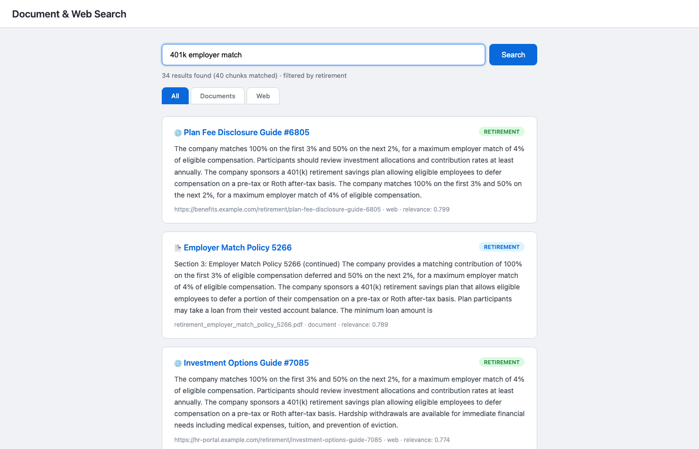
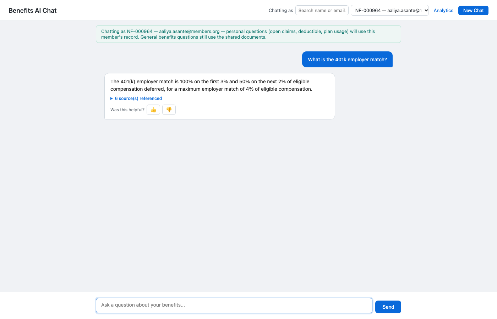
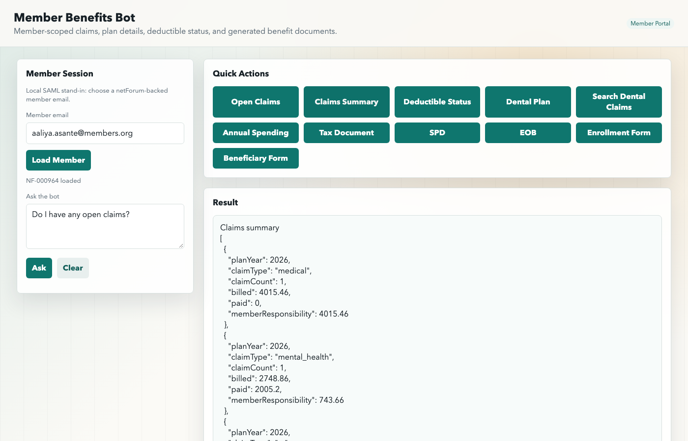

# document-search

Semantic search, RAG chat, and a member-facing benefits assistant over synthetic benefits content. The full documentation lives in [docs/README.md](docs/README.md).

## Screenshots

| Semantic Search | RAG Chat | Member Benefits Bot |
|---|---|---|
|  |  |  |

## Quick Start

```bash
npm run setup
```

When setup completes:

| Service | URL | Purpose |
|---|---|---|
| Search UI | `http://localhost:3000` | Semantic search across documents and web content |
| Admin dashboard | `http://localhost:3000/admin.html` | Manage indexed documents and web sources |
| GenAI chat UI | `http://localhost:3000/chat` | RAG-powered chat with analytics dashboard (`/chat/analytics.html`) |
| Member benefits UI | `http://localhost:3000/member` | Claims, plan details, enrollment comparison, and document generation |
| Ollama | `http://localhost:11434` | Local LLM runtime |
| PostgreSQL | `localhost:5433` | PostgreSQL 15 + pgvector |

All three experiences are served by the single `portal` service/container (`services/portal`); only Postgres and Ollama run as separate containers.

## Teardown

```bash
npm run teardown
```

## Documentation

| Document | Description |
|---|---|
| [docs/README.md](docs/README.md) | Full setup, API reference, data-flow diagrams, and environment variable reference |
| [docs/TECH_STACK.md](docs/TECH_STACK.md) | Current technology stack — runtime, frameworks, database, models, and tooling |
| [docs/diagrams/](docs/diagrams/) | Mermaid diagrams: system architecture, database schema, RAG chat sequence, ETL pipeline |
