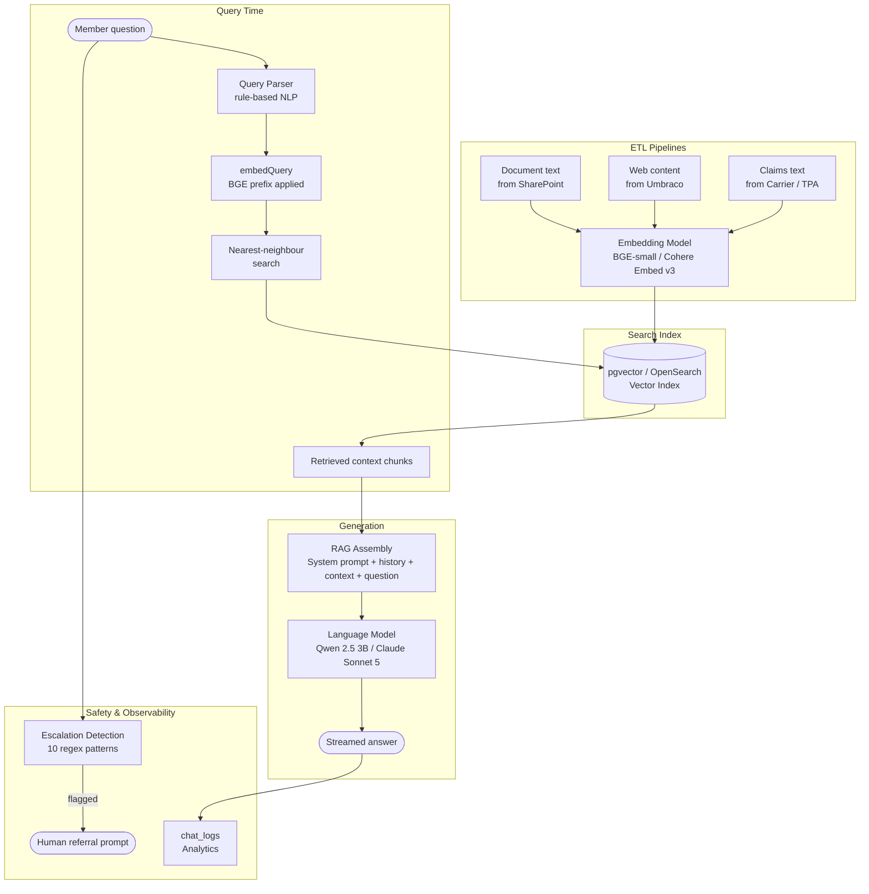

# How AI Is Used in This Solution

**Audience:** Executive and Technical Leadership  
**Date:** August 2026  
**Companion documents:** [Technical Solution](technicalsolution.md) · [The Problem](problem.md) · [Solution Benefits](benefits.md) · [AWS Production Architecture](../AWS_PRODUCTION_ARCHITECTURE.md) · [Slide Deck](presentation.md)

---

## Overview

The solution uses AI in two distinct ways: **machine learning models** that learn to represent meaning from data (the embedding model and the language model), and **deterministic rule-based systems** that detect specific patterns in text (query parsing and escalation detection). Both contribute to the member experience, and it is important to understand what each does, where it lives in the code, and how it will change in production.

| AI Component | Type | Where Used | PoC Technology | Production Technology |
|---|---|---|---|---|
| Text embedding | ML model | ETL pipelines + all search queries | BGE-small-en-v1.5 (ONNX, in-process) | Cohere Embed v3 via Amazon Bedrock |
| Vector similarity search | Algorithm (HNSW) | All three search APIs | pgvector on PostgreSQL | OpenSearch Serverless or Aurora + pgvector |
| Retrieval-augmented generation | Architectural pattern | Benefits Chat | Qwen 2.5 3B via Ollama | Claude Sonnet 5 via Amazon Bedrock |
| Query pre-processing | Rule-based NLP | Document & Web Search | `queryParser.js` — keyword aliasing + noise removal | Same pattern, extended |
| Escalation detection | Rule-based regex | Benefits Chat + Member Benefits Assistant | `escalation.js` — 10 regex patterns | Same pattern, candidate for ML classification at scale |

---

## 1. Text Embedding — Turning Words Into Meaning

### What it does

Every piece of content that enters the system — a page of a PDF, a section of a web article, a claims note — is passed through an **embedding model** that converts it into a list of 384 numbers (a vector). These numbers encode the semantic meaning of the text: documents about deductibles cluster together in vector space, documents about 401(k) loans cluster elsewhere.

When a member asks a question, the same model converts their question into a vector. The search system then finds content vectors that are closest to the question vector — not by matching words, but by matching meaning.

### How it is implemented

The embedding model is loaded once and shared via `lib/embedding.js`:

```js
// lib/embedding.js
const BGE_QUERY_PREFIX = 'Represent this sentence for searching relevant passages: ';

async function embedQuery(text) {
  return embed(BGE_QUERY_PREFIX + text);   // prefix applied at query time only
}

async function embed(text) {               // no prefix — used at index time
  const result = await model(text, { pooling: 'mean', normalize: true });
  return Array.from(result.data);          // 384-dimensional float array
}
```

**Asymmetric design:** The BGE model family uses a two-sided design. At indexing time, document text is embedded without a prefix. At query time, the prefix *"Represent this sentence for searching relevant passages: "* is prepended. This asymmetry is intentional and critical — removing the prefix from queries or adding it to documents silently degrades retrieval quality.

**Chunking:** Before embedding, documents are split into 500-character chunks with 50-character overlap. Each chunk is embedded independently and stored as a separate row in the vector index. This granularity allows retrieval to surface the specific paragraph that answers a question rather than a whole document.

**PoC model:** `Xenova/bge-small-en-v1.5` — 33M parameters, ONNX runtime, CPU-only, loaded via `@xenova/transformers`. Requires no external API. Each service loads the model independently at startup (~130 MB per container).

**Production upgrade:** Replaced with **Cohere Embed v3 via Amazon Bedrock** — 1024-dimensional vectors with substantially better semantic quality. The in-process model is removed entirely; embedding becomes an API call, so the application containers need no additional CPU or memory for it.

---

## 2. Vector Similarity Search — Finding the Closest Match

### What it does

Once all content is embedded, retrieval is a nearest-neighbour search in vector space. Given a query vector, the system finds the top-K stored vectors whose cosine distance to the query is smallest. These are the content chunks most semantically relevant to the question.

### How it is implemented

The vector index uses **HNSW (Hierarchical Navigable Small World)** — an approximate nearest-neighbour algorithm that trades a small amount of recall accuracy for fast sub-linear query time. The index is defined in `infra/db/init/`:

```sql
-- Cosine similarity HNSW index on document chunks
CREATE INDEX ON document_chunks USING hnsw (embedding vector_cosine_ops)
  WITH (m = 16, ef_construction = 64);
```

The same index structure is applied to web content chunks and claims text. Unified search across all three content types is handled by `sp_search_all()`, which queries each table and returns a merged, ranked result set.

Search calls in the application follow the same pattern across all three services:

```js
const queryEmbedding = await embedQuery(question);  // 384-float vector
const result = await pool.query(
  'SELECT * FROM sp_search_all($1, $2)',
  [`[${queryEmbedding.join(',')}]`, TOP_K]           // default top-10
);
```

**PoC:** pgvector on PostgreSQL 15 with HNSW indexes. Handles the PoC dataset (thousands of chunks) without any tuning.  
**Production:** Amazon OpenSearch Serverless with the vector engine (preferred for hybrid search and auto-scaling) or Amazon Aurora PostgreSQL + pgvector (preferred for SQL-centric teams at moderate scale).

---

## 3. Retrieval-Augmented Generation — Answering Questions

### What it does

RAG is the pattern that makes the chat interface work. It has three steps:

1. **Retrieve** — use semantic search to find the most relevant document chunks for the member's question
2. **Augment** — prepend those chunks to the message sent to the language model, as grounding context
3. **Generate** — the language model reads both the question and the retrieved context and writes an answer

The answer is grounded in the organisation's own content. The model cannot invent facts from outside the retrieved passages because the system prompt instructs it to answer only from context.

### How it is implemented

```js
// services/portal/src/routes/chat.js

const SYSTEM_PROMPT = `You are a helpful benefits assistant. Answer questions about
employee benefits using ONLY the provided context. If the context does not contain
enough information to answer, say so clearly. Be concise and cite which source
document or web page your answer comes from when possible.`;

// Build the message list
const ollamaMessages = [
  { role: 'system', content: SYSTEM_PROMPT },
  ...recentHistory,   // last 10 exchanges (20 messages), 30-minute session TTL
  {
    role: 'user',
    content: `Context from internal documents and web pages:\n${contextText}\n\nQuestion: ${question}`
  }
];
```

The context window is bounded at **6,000 characters** in the PoC (a constraint of the local 3B model). In production, Claude Sonnet 5's 1M-token context window allows this to expand to 50–100 retrieved chunks rather than the PoC's default of 10, dramatically improving answer coverage.

**Streaming:** Responses are streamed token-by-token via Server-Sent Events (SSE), so the member sees text appearing in real time rather than waiting for a complete response. The session ID, source citations, and an escalation flag are sent as HTTP response headers before streaming begins.

**Conversation history:** Each session maintains a rolling conversation history of the last 20 messages (approximately 10 exchanges). History is held in-memory with a 30-minute idle TTL. In production this moves to DynamoDB for persistence across restarts.

**PoC LLM:** Qwen 2.5 3B running locally via Ollama. A 3-billion-parameter model that fits and runs on a laptop CPU; adequate for PoC demonstration, not suitable for production quality or scale.  
**Production LLM:** Claude Sonnet 5 via Amazon Bedrock. 1M token context, 128K output, adaptive reasoning, no GPU management.

---

## 4. Query Pre-processing — Understanding Intent Before Embedding

### What it does

Before a search query is converted to a vector, `queryParser.js` applies two lightweight NLP transformations:

1. **Noise removal** — strips conversational preamble phrases (`"can you find me"`, `"tell me about"`, `"I need information on"`, etc.) so the embedding model receives clean topical text
2. **Category detection** — scans the query for 30+ keyword aliases and maps them to canonical benefit categories, enabling filtered search (e.g., `"401k loan"` → category `retirement`; `"vision exam"` → category `vision`)

This is **rule-based NLP, not a machine learning model**. The alias table is hand-curated and covers the vocabulary of the benefits domain.

```js
// services/portal/src/queryParser.js — category aliases (excerpt)
const CATEGORY_ALIASES = {
  '401k': 'retirement',  '401(k)': 'retirement',  'pension': 'retirement',
  'dental': 'dental',    'vision': 'vision',        'eye': 'vision',
  'fmla': 'fmla',        'maternity leave': 'fmla', 'std': 'disability',
  'hsa': 'hsa',          'eap': 'eap',              'cobra': 'cobra',
  // ...30 entries total
};
```

The cleaned query is passed to `embedQuery()`. If a category was detected, the search calls the filtered stored procedure (`sp_search_documents_filtered`) rather than the global one, narrowing results to that benefit type.

---

## 5. Escalation Detection — Identifying Members Who Need Human Support

### What it does

Every message sent to the Benefits Chat or Member Benefits Assistant is scanned for signals indicating the member may need to speak with a human. When a signal is found, a referral prompt is surfaced and the event is recorded in the analytics log.

### How it is implemented

`escalation.js` (shared by the Benefits Chat and Member Benefits Assistant routes) applies 10 regex patterns:

| Signal | Pattern Matches |
|---|---|
| `legal_representation` | "attorney", "lawyer", "legal counsel" |
| `litigation_threat` | "lawsuit", "suing", "sue", "litigation" |
| `formal_grievance` | "grievance", "formal complaint" |
| `state_regulator` | "insurance commissioner", "state board" |
| `federal_regulator` | "DOL", "Department of Labor", "ERISA" |
| `bbb_complaint` | "BBB", "Better Business Bureau" |
| `wrongful_denial` | "wrongful denial", "illegal denial", "unfair denial" |
| `discrimination_claim` | "discrimination" |
| `compliance_violation` | "compliance violation", "regulation violation" |
| `class_action` | "class action" |

Detection runs synchronously on every user message before the LLM call. Detected signals are stored in `chat_logs.escalation_signals` as an array and surfaced in the analytics dashboard.

This is **rule-based pattern matching, not an ML classifier**. It is deterministic and auditable — the full set of patterns is visible in the source code. At production scale, this could be extended or replaced with a fine-tuned intent classifier, but the regex approach is appropriate for the defined signal set and requires no training data or model management.

---

## 6. Analytics — Learning From Usage

All queries, source citations, escalation flags, and member feedback (thumbs up/down) are written to the `chat_logs` and `chat_feedback` tables. The `sp_analytics_summary()` stored procedure aggregates this data for the analytics dashboard (`/analytics.html` in the Benefits Chat service).

This data layer is the foundation for future ML improvements:

- **Retrieval quality signals** — thumbs-down ratings with low `sources_count` indicate retrieval is failing, not generation
- **Escalation rate trends** — rising escalation signals on specific topics surface content gaps
- **Query clustering** — repeated unanswered question patterns identify missing content
- **Fine-tuning candidates** — logged question/answer/rating triplets can form a training dataset for a future domain-specific model

---

## AI Component Map



---

## What AI Does Not Do in This Solution

Being precise about scope helps set correct expectations:

| Capability | In This Solution? | Notes |
|---|---|---|
| Retrieve member claims | No — SQL query | Claims data is fetched with a database query keyed on member identity; no AI involved |
| Generate plan documents | No — HTML template | Member-specific summary documents are generated from hardcoded plan data and SQL results |
| Decide coverage eligibility | No | The system surfaces existing information; it does not make eligibility or adjudication decisions |
| Learn or retrain from feedback | Not in PoC | Analytics data is stored and available; a retraining pipeline is a future phase |
| Guarantee factual accuracy | No | The LLM generates answers from retrieved context; source attribution is provided, but responses should be reviewed for high-stakes decisions |

---

## Guardrails

| Guardrail | Implementation |
|---|---|
| Answers grounded in source documents | System prompt explicitly restricts the model to answer from provided context only |
| Source citations in every response | Retrieved chunk metadata (title, category, document reference) is attached to every response |
| Escalation detection | 10 deterministic patterns trigger a human referral prompt before the LLM can attempt an answer |
| Member data isolation | Claims and deductible data is scoped by authenticated member identity; no cross-member data leakage |
| No PII in embeddings | Claims text fields selected for embedding contain provider, claim type, and status — not personal health details |
| Audit trail | All queries, escalation flags, and ratings are persisted to `chat_logs` for review |
