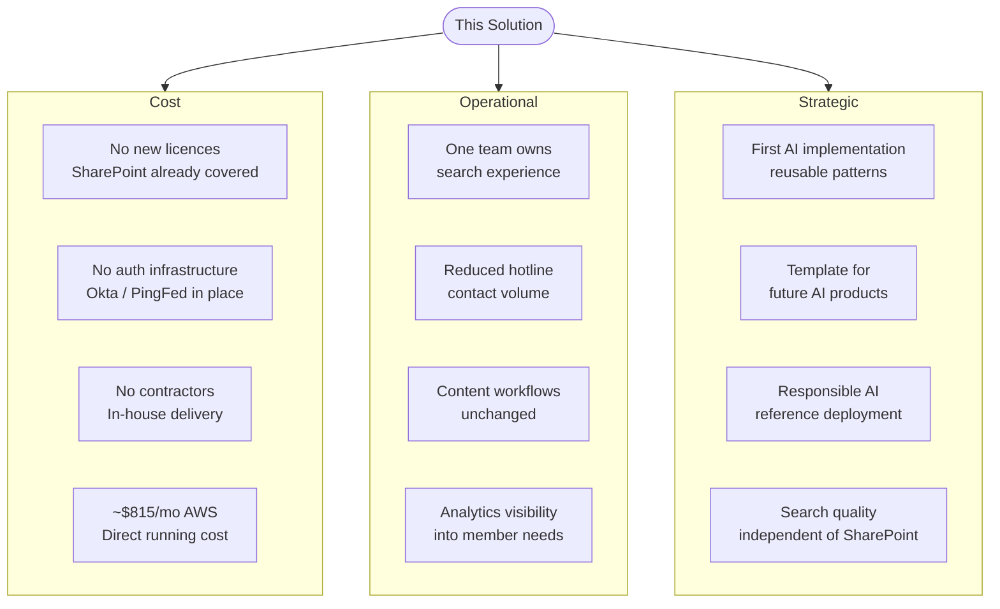

# Solution Benefits

**Audience:** Executive and Technical Leadership  
**Date:** August 2026  
**Companion documents:** [The Problem](problem.md) · [Technical Solution](technicalsolution.md) · [How AI Is Used](aiusage.md) · [AWS Production Architecture](../AWS_PRODUCTION_ARCHITECTURE.md) · [Slide Deck](presentation.md)

---

## Summary

This solution delivers measurable cost savings, operational consolidation, and a meaningfully better experience for members and administrators — at a direct AWS running cost of approximately **$815 per month in production** and **$175 per month in dev/test**. The majority of what would ordinarily drive the cost of a project like this — licenses, authentication infrastructure, content systems, and development labour — is already in place or in-house.

Using live contractor market data (IT Jobs Watch, August 2026, converted to USD at £1 = $1.30), a comparable contractor engagement would cost **~$198,000–$267,000** for the initial build, with ongoing support adding a further **~$30,000–$66,000 per year**. In-house delivery avoids that cost entirely.

---

## Cost Profile

### Direct Costs — What We Pay to Run It

| Item | Cost | Notes |
|---|---|---|
| AWS infrastructure (production) | ~$815 / month | EKS + Aurora PostgreSQL + Claude Sonnet 5; see [full breakdown](../AWS_PRODUCTION_ARCHITECTURE.md) |
| AWS infrastructure (dev/test) | ~$175 / month | Sized down; used during development and for ongoing testing |
| **Total direct AWS cost** | **~$11,900 / year** | Production environment only; ~$14,000/yr including dev/test |

Lower-cost configurations are available if required:

| Configuration | Production Monthly Cost |
|---|---|
| EKS + Aurora + Claude Sonnet 5 (recommended) | ~$815 |
| EKS + Aurora + Claude Haiku 4.5 (cost-optimised) | ~$615 |
| Lambda + Aurora + Claude Sonnet 5 (serverless fallback) | ~$645 |

### Comparison with Comparable SaaS Products

The most direct alternative to building this on AWS is licensing an enterprise AI search or HR chatbot platform. Three categories are relevant to this use case:

| Product Category | Example Vendors | Typical Pricing Model | Est. Annual Cost — 500 users | Est. Annual Cost — 1,000 users |
|---|---|---|---|---|
| **Enterprise AI Search** | Glean, Coveo, Lucidworks | Per-user/month (enterprise contract) | ~$150,000 – $180,000 ¹ | ~$300,000 – $360,000 |
| **HR / Benefits AI Chatbot** | Leena AI, AskHR, Moveworks | Per-employee/month | ~$60,000 – $120,000 | ~$120,000 – $240,000 |
| **This solution (AWS)** | — | Fixed infrastructure + usage-based tokens | **~$9,800** | **~$11,000** ² |

¹ *Glean and Coveo do not publish list pricing; enterprise contracts are negotiated. Estimates are based on analyst reports and publicly reported deal ranges ($20–$30/user/month).*  
² *AWS costs are primarily fixed (EKS, Aurora). Token costs grow with query volume, not user count. At double the baseline query volume (20K chat queries/day), estimated production cost rises to approximately ~$1,100/month — still far below per-user SaaS pricing at any meaningful employee count.*

#### Why the Gap Is So Large

SaaS platforms price per user because they are general-purpose tools licensed across a workforce. This solution is purpose-built for a single use case — benefits search and claims self-service — and its AWS running cost scales with **query volume**, not **headcount**. A 1,000-employee organisation that generates 10,000 chat queries per day pays the same AWS bill as a 200-employee organisation generating the same query volume.

#### What SaaS Includes That AWS Does Not

A direct cost comparison understates SaaS value in some areas:

| Capability | SaaS Platform | This AWS Solution |
|---|---|---|
| Vendor support and SLA | Included in licence | Internal team responsibility |
| Automatic model and feature updates | Included | Requires internal update work |
| Pre-built connectors to 100+ enterprise apps | Included | SharePoint, Umbraco, and claims only (by design) |
| No-code admin configuration | Typically included | Configuration requires developer access |

#### What AWS Provides That SaaS Does Not

| Capability | SaaS Platform | This AWS Solution |
|---|---|---|
| Custom system prompt and answer grounding | Vendor-controlled | Fully controlled by the team |
| Data stays within your AWS account | Varies by vendor / data region | Yes — no data leaves the org's AWS environment |
| Customisable escalation logic | Limited | Full control (regex patterns + future ML) |
| Integration with claims and deductible data | Not typically available | Native — purpose-built for this data |
| Source code ownership | No | Yes — full codebase in-house |
| No per-user licence negotiation | N/A | No per-user cost |

#### 5-Year Cost Projection

| Scenario | Year 1 | Year 2 | Year 3 | Year 4 | Year 5 | **5-Year Total** |
|---|---|---|---|---|---|---|
| Enterprise AI Search (1,000 users) | $300,000 | $300,000 | $300,000 | $300,000 | $300,000 | **$1,500,000** |
| HR Chatbot (1,000 users) | $120,000 | $120,000 | $120,000 | $120,000 | $120,000 | **$600,000** |
| This solution (AWS) | $9,800 | $9,800 | $9,800 | $9,800 | $9,800 | **$49,000** |

*AWS costs assume flat usage profile. SaaS costs assume no price increases over 5 years (historically conservative — enterprise software pricing typically increases 5–10% annually at renewal).*

---

### Avoided Costs — What We Do Not Need to Buy

| Item | Why It Is Not a Cost |
|---|---|
| **SharePoint Online licences** | Already licensed across the organisation; the solution reads from SharePoint via the Graph API and incurs no additional licence cost |
| **Authentication infrastructure** | Okta → PingFederate SSO is already deployed; integration is configuration work against the existing enterprise identity provider |
| **Search vendor or platform** | No third-party search product is introduced; the search layer is built on AWS-managed services using existing cloud infrastructure patterns |
| **External development labour** | Development is in-house; no contractors or external agencies are required to build or complete this solution — see the [contractor cost comparison](#development-labour--in-house-vs-contractor) below for the avoided cost value |
| **Content system changes** | SharePoint and Umbraco remain the systems of record; content owners continue to work in the tools they already use |

### Development Labour — In-House vs. Contractor

The proof of concept has been built by the internal team. The remaining work to reach production is structured as six documented phases. This section compares the cost of completing that work in-house against the cost of sourcing and engaging external contractors to do the same.

#### What the Project Requires

To build this solution from a standing start, a contractor engagement would need to cover three capability areas simultaneously:

| Role | Skills Required | Market Rate (USD equiv., August 2026) |
|---|---|---|
| **ML / AI Engineer** | RAG architecture, LLM integration, vector embeddings, Bedrock, pgvector | $750 – $950 / day ¹ |
| **Senior Full-Stack Developer** | Node.js, Express, PostgreSQL, REST API design, SSE streaming | $600 – $800 / day |
| **AWS / DevOps Engineer** | EKS, Step Functions, Lambda, Aurora, VPC, Secrets Manager, CI/CD | $650 – $850 / day |

¹ *Source: IT Jobs Watch live market data, 4 August 2026 (UK median ML Engineer contract rate £575/day, converted at £1 = $1.30). RAG and Generative AI appear in 22% of ML Engineer contract postings, placing this role at the higher end of the range.*

#### Finding Contractors — Before Work Begins

Sourcing specialist AI contractors is not a short process. Realistically:

| Activity | Estimated Cost / Time |
|---|---|
| Internal sourcing (HR + manager time, job boards, LinkedIn Recruiter) | 60–120 hours internal time + $2,500–$6,500 advertising |
| Staffing agency engagement *(if used)* | 15–20% margin on daily rate, billed throughout the engagement |
| Vetting, interviews, and reference checks per role | 2–4 weeks elapsed time per role |
| Onboarding, NDAs, SOW negotiation, IT access provisioning | $6,500–$13,000 in legal and admin costs |
| **Elapsed time before first line of production code** | **4–8 weeks** |

#### Contract Development Cost

Based on a two-contractor engagement (ML/AI engineer + combined Full-Stack/DevOps) over a realistic delivery timeline of **5–6 months**:

| Item | Low Estimate | High Estimate |
|---|---|---|
| ML / AI Engineer (5 months × 20 days × $780/day) | $78,000 | $95,000 |
| Senior Full-Stack / DevOps (5 months × 20 days × $715/day) | $72,000 | $85,000 |
| **Subtotal — contractor labour** | **$150,000** | **$180,000** |
| Staffing agency margin (15–20%) *(if using agency)* | $22,000 | $36,000 |
| Contractor compliance and employment taxes *(W-2 conversion, FICA, benefits if reclassified)* | $20,000 | $39,000 |
| Onboarding and legal | $6,500 | $13,000 |
| **Total estimated contractor engagement cost** | **~$198,000** | **~$267,000** |

A three-contractor engagement would compress the timeline to 3–4 months but increase total cost by a further $52,000–$78,000.

#### Ongoing Contractor Support

If the solution is built by contractors, ongoing maintenance and feature development typically requires retaining access to that knowledge — either through renewed contracts or a handover period to internal staff. Industry benchmarks put annual support and enhancement contracts at 15–25% of initial build cost:

| Year | Ongoing contractor support estimate |
|---|---|
| Year 1 (build) | $198,000 – $267,000 |
| Year 2 (support + enhancements) | $30,000 – $66,000 |
| Year 3 | $30,000 – $66,000 |
| **3-year total** | **~$258,000 – $399,000** |

#### In-House Comparison

| Item | In-House | Contractor |
|---|---|---|
| Development labour | Existing team cost (already budgeted) | $198,000 – $267,000 upfront |
| Time to start | Immediately — PoC is already built | 4–8 weeks sourcing delay |
| AWS running cost (Year 1 production) | ~$9,800 | ~$9,800 |
| Year 2–3 maintenance | Existing team | $30,000 – $66,000 / year |
| Knowledge retention | Stays with the team | Leaves with the contractor |
| Future AI project acceleration | Patterns and code reused internally | Requires sourcing again |
| **3-year total (AWS only vs. contractor + AWS)** | **~$30,000** | **~$268,000 – $412,000** |

The in-house delivery model carries the same $815/month AWS running cost. The avoided contractor cost represents a one-time saving of $198,000–$267,000 plus compounding savings on every subsequent AI project the team builds from these patterns.

---

## Operational Benefits

### Search Ownership Consolidated to One Team

The current search experience is distributed responsibility: the SharePoint environment is managed by one team, the Umbraco website by another, claims data by a third, and the HR hotline serves as the integration layer when those systems fail to answer a member's question. No single team owns the end-to-end member search experience.

This solution consolidates that:

| Current State | With This Solution |
|---|---|
| Multiple teams each maintaining separate search surfaces | One team operates a single unified search and chat layer |
| No team owns the member's end-to-end experience | Clear ownership of the full journey from question to answer |
| Changes to one system require coordination across teams | Content changes in SharePoint or Umbraco are picked up automatically by ETL pipelines |
| No visibility into what members are searching for | Analytics dashboard provides real-time query, escalation, and feedback data |

### Reduced Contact Volume for Routine Questions

A measurable share of HR hotline contact volume consists of questions that are answered in the existing document and web content library. Every such call that is resolved through self-service represents direct time savings for benefits administrators — time that can be redirected to complex member needs, exception handling, and high-value casework.

The solution does not eliminate the need for human support. It removes the category of calls that should never have needed a human in the first place.

### Content Teams Unchanged

Content owners in SharePoint and the Umbraco editorial team make no changes to their workflows. Documents are uploaded and managed in SharePoint as today. Web pages are published through the Umbraco back office as today. The ETL pipelines handle synchronisation automatically — new or updated content becomes searchable without any manual re-indexing step.

---

## Strategic Benefits

### First AI Implementation — A Template for Future Work

This project is the organisation's first production AI deployment built on the internal team's own infrastructure. That gives it value beyond what it delivers to members directly.

The patterns established here are reusable:

| Pattern | What It Establishes |
|---|---|
| Embedding pipeline | A shared, tested approach to turning any text content into a semantic search index; applicable to any future search or recommendation product |
| RAG architecture | A grounded, auditable approach to building AI chat; the system prompt discipline, context assembly pattern, and source-citation approach carry to any domain |
| ETL orchestration | Step Functions + Lambda (or EKS CronJob) pattern for scheduled, idempotent data ingestion from enterprise sources; reusable for HR, finance, or operational data |
| Analytics and feedback loop | A schema and dashboard pattern for capturing AI system quality signals; a foundation for continuous improvement and future model evaluation |
| Escalation detection | A deterministic, auditable safety layer that can be extended to any AI-facing member interaction |
| Security and auth patterns | Okta → PingFederate → ALB OIDC integration, Secrets Manager for credentials, private VPC deployment — documented and validated for reuse |

The next AI product the team builds will start from a working reference implementation, not from scratch. The difference in time-to-delivery for a second project, using proven in-house patterns, is substantial.

### Demonstrates Responsible AI Deployment

This project demonstrates that the team can deploy AI systems with:

- **Grounded answers** — the language model is constrained to answer from retrieved source documents; it does not fabricate
- **Source attribution** — every chat response cites the document or web page it was drawn from
- **Deterministic safety** — escalation detection runs on every message before the LLM, using auditable code rather than probabilistic classification
- **Member data isolation** — claims and deductible data is enforced at the API layer by authenticated member identity
- **Audit trail** — all queries, escalation events, and member ratings are logged and reviewable

This is a deployable reference for responsible AI practice that the organisation can point to when future projects are evaluated for risk.

### Reduces Dependency on SharePoint's Built-In Search

The current search capability is bound to SharePoint's keyword index, which has no roadmap for semantic or conversational improvement within the organisation's existing environment. This solution makes the quality of member search independent of SharePoint's search capability — SharePoint becomes a document store, not a search engine. Future improvements to search quality (better embedding models, re-ranking, hybrid search) are decisions within the team's control.

---

## Benefits Summary

---

## Risk Profile

The PoC-first approach deliberately contains risk:

| Risk | Mitigation |
|---|---|
| AI answer quality | System prompt restricts answers to retrieved content; source citations allow members to verify; feedback ratings identify gaps |
| Sensitive member data | Claims data is isolated behind authenticated API routes; no PII fields are embedded or passed to the language model |
| Vendor lock-in | Embedding and LLM are API calls behind a thin abstraction; switching models requires changing one configuration value and re-vectorising content |
| AWS cost overrun | Aurora Serverless v2 and Lambda fallback both scale to zero or near-zero at low load; cost scales with usage, not with a reserved baseline |
| Team capability gap | The PoC is built and documented by the internal team; knowledge is not held by a single person or external vendor |
| Content accuracy | The system surfaces existing content; it does not create new content. Content accuracy is owned by the teams who maintain SharePoint and Umbraco |
