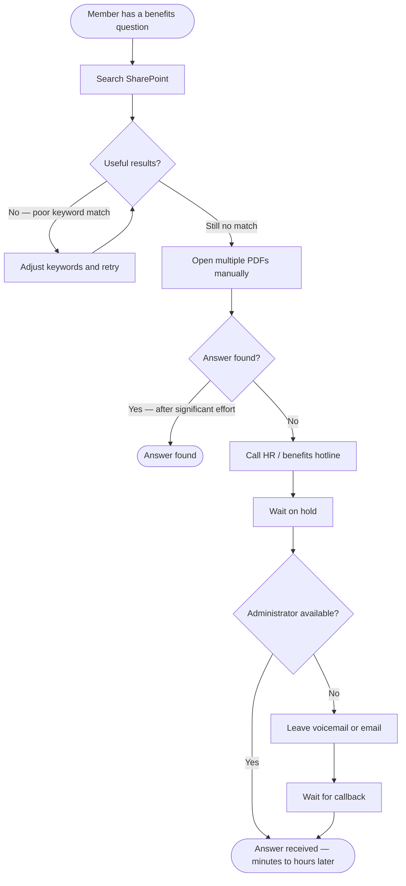
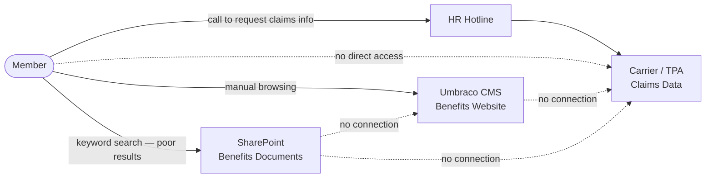

# The Problem — Why We Built This

**Audience:** Executive and Technical Leadership  
**Date:** August 2026

---

## Background

Our organisation provides members and benefits administrators with access to a broad set of employee benefits: health plans, 401(k) provisions, claims history, deductible tracking, and a library of supporting documents. This content lives across two systems — a legacy SharePoint environment and a public-facing web presence managed through Umbraco CMS — alongside claims data held by carriers and third-party administrators.

Members need to find accurate, timely answers to benefits questions. Benefits administrators need to support them efficiently. Neither group is well-served by the tools currently available.

---

## Current State — What Is Not Working

### 1. Search That Does Not Find the Right Answer

The current search experience is powered by a legacy SharePoint keyword index. Users must know exactly which word appears in the document they are looking for. If a member asks whether their plan covers a specific procedure, or wants to understand how a deductible resets, keyword search returns a list of loosely related documents with no indication of which one answers their question.

**The result:** Members abandon the search, read multiple documents from start to finish in the hope of finding an answer, or give up entirely and call the benefits hotline.

This is not a content problem. The answers exist. The search technology cannot connect the question to the answer.

### 2. No Conversational Interface

There is no chatbot or guided Q&A experience. Every interaction requires the member to locate the right document, open it, and read through it manually — often for a single factual answer such as:

- *"What is my in-network deductible for the year?"*
- *"Can I take a loan from my 401(k) and what are the repayment terms?"*
- *"Has my recent claim been processed?"*

When benefits information is spread across PDFs, plan summaries, and web pages, no single document answers a typical member question. Members must synthesise across sources themselves.

### 3. High Contact Volume for Answerable Questions

When self-service fails, members call HR or the benefits hotline. A significant share of this contact volume consists of questions that are already answered in the existing document and web content library — questions about coverage, eligibility, deductible status, and plan comparisons. These calls are:

- **Costly** — each call requires a trained administrator's time for a question that could be answered instantly by the system.
- **Slow** — members wait on hold for routine information.
- **Inconsistent** — the answer depends on which administrator takes the call and how recently they reviewed the source material.

Benefits administrators spend a disproportionate amount of their time answering repetitive, low-complexity questions rather than supporting members with genuinely complex needs.

### 4. Claims and Deductible Information Is Not Self-Serve

Claims status, deductible progress, and claims activity history are available from carriers and third-party administrators, but this data is not exposed to members in a usable form. Members who want to understand whether a claim has been processed, what their current out-of-pocket exposure is, or how their plan year is tracking must call to ask.

The data exists. The connection between that data and the member does not.

### 5. Fragmented Content Means No Single Source of Truth

Benefits content is distributed across at least two systems (SharePoint and Umbraco) with no unified search across them. A member searching for information about a specific benefit may find partial answers in one system and not know that additional content exists in the other. Administrators face the same problem when triaging member queries.

---

## Impact

| Dimension | Effect |
|---|---|
| **Member experience** | Frustration from failed searches, time spent reading documents manually, and reliance on a phone call for routine questions |
| **Administrator efficiency** | High contact volume for answerable questions, reducing capacity for complex case support |
| **Answer consistency** | Answers vary by channel (call vs. search vs. document), creating confusion and eroding trust |
| **Operational cost** | Every avoidable call represents staff time and infrastructure cost that scales with member population |
| **Content investment** | Significant effort goes into creating and maintaining benefits documentation that members cannot effectively find or use |

---

## What This Project Addresses

This proof-of-concept directly addresses each of these five problems:

| Problem | Solution |
|---|---|
| Keyword search returns poor results | Semantic vector search — queries are matched by *meaning*, not exact keywords |
| No way to ask a question and get an answer | RAG chat interface — members ask in plain language and receive a generated answer grounded in the actual document and web content library |
| Answerable questions drive call volume | Self-service chat reduces the need to call for routine benefits questions |
| Claims and deductible data is not self-serve | Member benefits assistant surfaces claims status, deductible progress, and plan comparisons directly to the authenticated member |
| Content is fragmented across systems | Unified search index across documents (SharePoint), web content (Umbraco), and claims data — a single retrieval layer over all sources |

The system is a proof of concept running on synthetic data. It demonstrates that the technology stack required to solve these problems is mature, available, and deployable on AWS at a predictable cost. See [AWS_PRODUCTION_ARCHITECTURE.md](../AWS_PRODUCTION_ARCHITECTURE.md) for the production path and cost estimates.
