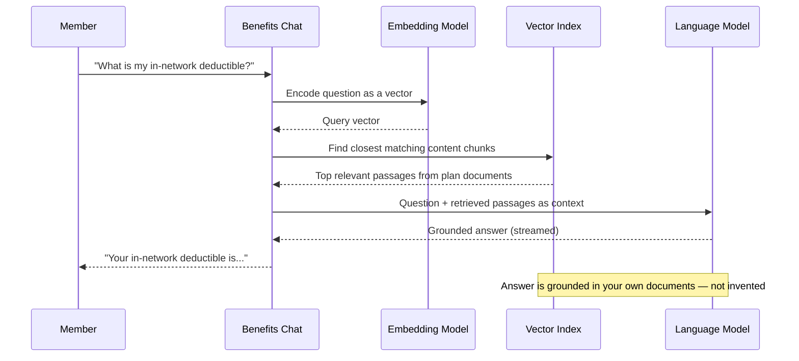
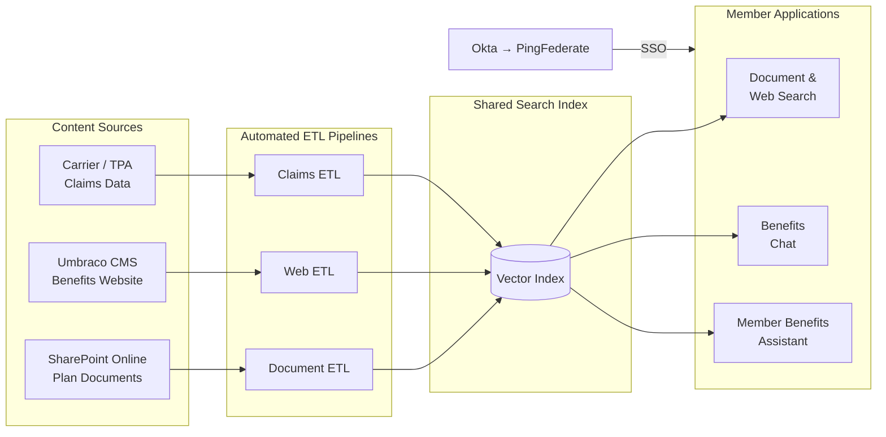
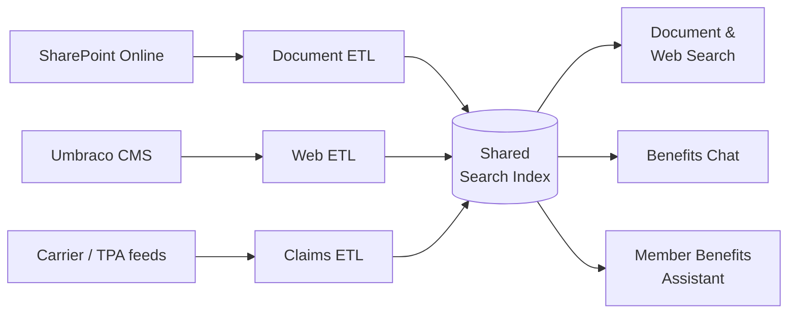
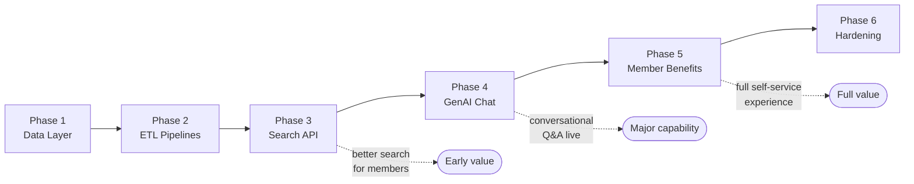

# Technical Solution

**Audience:** Executive and Technical Leadership  
**Date:** August 2026  
**Companion documents:** [The Problem](problem.md) · [AWS Production Architecture](../AWS_PRODUCTION_ARCHITECTURE.md)

---

## Overview

The solution is a unified benefits intelligence platform composed of three user-facing applications backed by a shared search index. It replaces keyword-based SharePoint search with AI-powered semantic retrieval, adds a conversational chat interface grounded in the actual benefits document library, and gives members direct self-service access to their claims and deductible data.

A proof of concept has been built and validated on synthetic data. It runs locally with Docker, demonstrates the full end-to-end capability, and maps directly to a production deployment on AWS.

---

## How the Core Technology Works

### Semantic Search

Traditional keyword search looks for exact word matches. A search for *"out-of-pocket maximum"* returns documents that contain those words — and misses documents that say *"annual cost limit"* or *"maximum member liability"*.

Semantic search converts text into a numerical fingerprint — called a **vector embedding** — that encodes meaning rather than vocabulary. Queries and documents are both converted to embeddings, and the system finds content that is *conceptually close* to the question, regardless of whether it uses the same words. The result is that natural-language questions like *"Can I keep my doctor if I switch plans?"* reliably surface the right content.

### Retrieval-Augmented Generation (RAG)

A language model alone cannot answer questions about your specific plan documents — it has no access to them. RAG combines retrieval and generation: the system first finds the most relevant passages from your own content library using semantic search, then passes those passages to a language model as context, and the model generates an answer grounded in those specific passages.

The user gets a direct answer in plain language. Every answer is derived from content your organisation already owns and maintains. The model does not guess or fabricate — if the answer is not in the retrieved content, the system says so.

---

## What Was Built

### Three User-Facing Applications

| Application | Who Uses It | What It Does |
|---|---|---|
| **Document & Web Search** | Members, administrators | Semantic search across the full benefits document library and website content; returns ranked results with source attribution |
| **Benefits Chat** | Members | Conversational Q&A grounded in the benefits library; streaming responses with conversation history; escalation detection when complex needs are identified |
| **Member Benefits Assistant** | Members | Personalised view of the member's own claims, deductible status, plan details, and comparisons; generates member-specific summary documents on demand |

All three applications authenticate through the organisation's existing **Okta → PingFederate** SSO. The member benefits assistant propagates the authenticated member's identity to enforce row-level data access — each member sees only their own claims and documents.

Benefits Chat has since been extended so it can also answer a member's personal questions (open claims, deductible status) in the same conversation as general benefits questions, rather than requiring a separate tool — the PoC demonstrates this by letting the demo operator select which member's context to include. The Member Benefits Assistant remains the primary, fully-featured self-service surface for claims and document generation; the chat enhancement shows what a single, unified conversational entry point could look like in production once tied to real member authentication.

### Unified Search Index

All three applications draw from a single shared search index backed by **PostgreSQL with the pgvector extension**. The index holds:

- Document content — extracted from benefits PDFs, broken into searchable chunks
- Web content — extracted from the benefits website (Umbraco CMS), chunked by section
- Claims data — member claims lines and activity events, with text fields made searchable

The index is kept current by three automated pipelines (see [Data Pipelines](#data-pipelines) below).

### Escalation and Analytics

The chat application monitors conversations for signals that indicate the member needs human support — unresolved questions after multiple turns, expressions of frustration, requests for exceptions, or topics involving appeals and legal rights. When an escalation is detected, the system surfaces a referral prompt. All queries, ratings, and escalation events are logged for analysis, and an analytics dashboard gives administrators visibility into what members are asking, where answers are failing, and escalation rates.

---

## Data Pipelines

Three automated ETL pipelines keep the search index current. Each runs on a schedule and applies an upsert strategy — only changed content is re-embedded, making incremental runs fast.

| Pipeline | Source | Content |
|---|---|---|
| **Document ETL** | SharePoint Online (Microsoft 365) | PDFs, DOCX, PPTX — plan documents, SPDs, policy guides |
| **Web ETL** | Umbraco CMS | Published web pages — benefit guides, FAQs, articles |
| **Claims ETL** | Carrier or TPA data feed | Member claims lines, adjudication status, activity logs |

Connectors to the live SharePoint and Umbraco systems are specified in the AWS architecture. In the PoC, these pipelines run against 1,500 synthetic documents, 700 synthetic web pages, and synthetic claims data to demonstrate the full flow without accessing production systems.

---

## AI and Search Technology

### Proof of Concept Choices

| Component | PoC Technology | Rationale |
|---|---|---|
| Embedding model | BGE-small (ONNX, in-process, 384 dimensions) | Runs on CPU with no external dependencies; suitable for local development |
| Language model | Qwen 2.5 3B via Ollama (local, CPU) | Fits on a laptop; demonstrates the RAG pattern without cloud dependencies |
| Vector database | PostgreSQL 15 + pgvector (HNSW index) | Simple, no additional infrastructure; cosine similarity search at PoC scale |

### Production Upgrades

| Component | Production Technology | Why |
|---|---|---|
| Embedding model | Cohere Embed v3 via Amazon Bedrock (1024 dimensions) | Substantially higher retrieval quality; flexible dimensions; managed API with no model hosting |
| Language model | Claude Sonnet 5 via Amazon Bedrock | 1M token context window; high-quality, grounded answers; fast; no GPU management |
| Vector database | Amazon OpenSearch Serverless or Aurora PostgreSQL + pgvector | Native hybrid search (keyword + vector combined); auto-scales; no cluster management |
| Re-ranking | Cohere Rerank 3.5 via Amazon Bedrock | Improves retrieval precision by re-scoring the top vector results before passing to the LLM |

The production embedding and language model are both managed API calls — the application servers have no GPU requirement and require minimal compute.

---

## Production Architecture on AWS

The full production architecture is detailed in [AWS_PRODUCTION_ARCHITECTURE.md](../AWS_PRODUCTION_ARCHITECTURE.md). The key structural points for this audience:

### Compute

All three API services run as containerised workloads on **Amazon EKS** (Kubernetes), the organisation's approved container platform. ETL pipelines run as Kubernetes `CronJob` resources. If EKS is not available in the target account at deployment time, the fallback path packages each service as an **AWS Lambda** function behind **API Gateway**.

### Data

| Data Type | AWS Service |
|---|---|
| Vector search index | Amazon OpenSearch Serverless *or* Aurora PostgreSQL + pgvector |
| Member claims and deductibles | Aurora PostgreSQL (member-scoped, separate from the content index) |
| ETL staging (temporary) | Amazon S3 (7-day lifecycle, not the source of truth) |
| Generated member documents | Amazon S3 with presigned download URLs |

Documents remain authoritative in SharePoint. Web content remains authoritative in Umbraco. AWS stores only the indexed chunks and temporary staging copies.

### Authentication

User authentication flows through the existing **Okta → PingFederate** SSO. The Application Load Balancer (ALB) acts as the OIDC relying party — it validates tokens issued by PingFederate before routing any request to a backend service. No authentication infrastructure needs to be built; integration is configuration-level work against the existing enterprise IdP.

### Security Posture

- All services run in **private subnets** within a VPC; no direct internet access
- **AWS WAF** on the ALB and CloudFront distribution
- Credentials (SharePoint, Umbraco, database) stored in **AWS Secrets Manager** with rotation
- Audit trail via **CloudTrail**; anomaly detection via **GuardDuty**

---

## Proof of Concept vs Production — Summary

| Dimension | Proof of Concept | Production |
|---|---|---|
| Data | 1,500 synthetic PDFs, 700 synthetic web pages, synthetic claims | Live SharePoint, Umbraco, and carrier/TPA feeds |
| Embedding | BGE-small, CPU, in-process (384d) | Cohere Embed v3 via Bedrock (1024d) |
| Language model | Qwen 2.5 3B, local Ollama | Claude Sonnet 5 via Bedrock |
| Vector store | PostgreSQL + pgvector | OpenSearch Serverless or Aurora + pgvector |
| Compute | Docker Compose on a laptop | Amazon EKS (Lambda fallback) |
| Auth | Open in local dev; API key on member app | Okta → PingFederate → ALB OIDC |
| ETL orchestration | node-cron in containers | AWS Step Functions + Lambda |
| Cost | ~$0 (local) | ~$815/mo production · ~$175/mo dev/test (EKS + Aurora + Sonnet 5) |

---

## Migration Phases

The production path is structured as six phases, each independently deliverable:

| Phase | Deliverable |
|---|---|
| 1 | Data layer: Aurora PostgreSQL, S3 staging; SharePoint and Umbraco connector setup |
| 2 | ETL pipelines: document, web, and claims ingestion against live sources |
| 3 | Search API on EKS (or Lambda); semantic search live against real content |
| 4 | GenAI chat on EKS (or Lambda); RAG against real content; Bedrock LLM |
| 5 | Member benefits assistant on EKS (or Lambda); real claims data; Okta/PingFed auth |
| 6 | Production hardening: WAF, GuardDuty, CloudTrail, CI/CD, load testing |

After Phase 3, members have meaningfully better search than today. Each subsequent phase adds a new capability.
