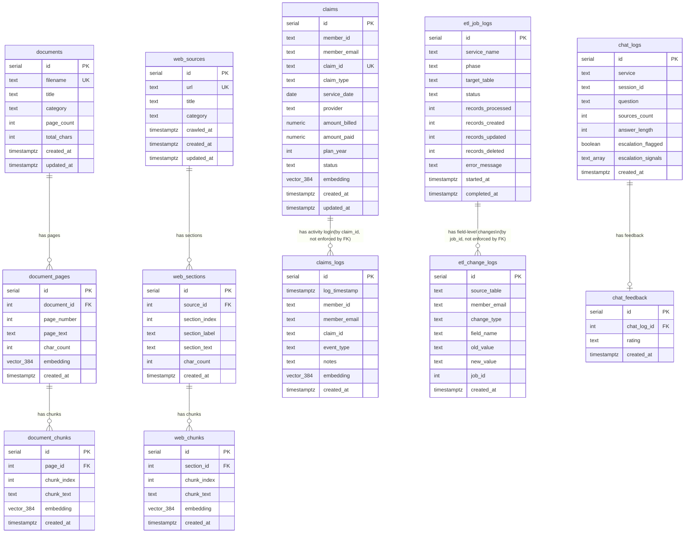

# Database Schema

The database has three independent content pipelines (documents, web content, claims) and three cross-cutting support tables (chat logging, ETL job history, and per-field ETL change logging).

## Index Summary

| Table | Index type | Column(s) | Purpose |
|---|---|---|---|
| `document_pages` | HNSW cosine | `embedding` | Semantic page-level search |
| `document_chunks` | HNSW cosine | `embedding` | Semantic chunk-level search |
| `web_chunks` | HNSW cosine | `embedding` | Semantic web-content search |
| `claims` | HNSW cosine | `embedding` | Semantic claims search (index exists; no search procedure uses it yet) |
| `claims` | B-tree | `(member_id, service_date DESC)` | Member claim lookups |
| `claims` | B-tree | `member_email` | Email-based member resolution |
| `claims` | B-tree | `status` | Open/closed claim filtering |
| `claims_logs` | HNSW cosine | `embedding` | Semantic claim-activity search (index exists; no search procedure uses it yet) |
| `claims_logs` | B-tree | `(member_id, log_timestamp DESC)` | Member activity lookups |
| `claims_logs` | B-tree | `claim_id` | Per-claim activity lookups |
| `etl_change_logs` | B-tree | `(source_table, created_at DESC)` | Change-log time-window queries |
| `etl_change_logs` | B-tree | `member_email` | Per-member change lookups |
| `etl_change_logs` | B-tree | `job_id` | Per-job change lookups |
| `chat_logs` | B-tree | `(service, created_at DESC)` | Analytics time-window queries |
| `chat_logs` | Partial B-tree | `created_at DESC WHERE escalation_flagged` | Fast escalation dashboard queries |
| `chat_feedback` | Unique B-tree | `chat_log_id` | Prevent duplicate ratings |

## Search Stored Procedures

| Procedure | Input | Searches |
|---|---|---|
| `sp_search_documents(embedding, top_k)` | 384d vector | `document_chunks` |
| `sp_search_documents_filtered(embedding, top_k, category)` | 384d vector + category | `document_chunks` WHERE category |
| `sp_search_pages(embedding, top_k)` | 384d vector | `document_pages` |
| `sp_search_web(embedding, top_k)` | 384d vector | `web_chunks` |
| `sp_search_all(embedding, top_k)` | 384d vector | `document_chunks` UNION ALL `web_chunks` |
| `sp_search_all_filtered(embedding, top_k, category)` | 384d vector + category | Both, filtered by category |
| `sp_analytics_summary(days)` | int | `chat_logs` LEFT JOIN `chat_feedback` |

Note: `claims` and `claims_logs` have embeddings and HNSW indexes but no semantic search procedure exists yet. The chat routes' member-context feature (`services/portal/src/routes/chat.js`) reads claims with plain SQL (`getOpenClaims`, `getClaimsSummary`, `getDeductibleStatus`), not vector search. See the "Merge the member bot into chat" discussion for the tradeoffs of adding a `sp_search_claims`.

## Claims ETL Procedures

| Procedure | Type | Purpose |
|---|---|---|
| `sp_upsert_claim(...)` | PROCEDURE (`CALL`) | Insert/update a claim row |
| `sp_get_existing_claims()` | FUNCTION (`SELECT`) | Fetch all claims for change-detection diffing |
| `sp_delete_claim(claim_id)` | PROCEDURE (`CALL`) | Remove a claim no longer present in the source |
| `sp_insert_claim_log(...)` | PROCEDURE (`CALL`) | Insert a claims activity-log row |
| `sp_truncate_claims_logs()` | PROCEDURE (`CALL`) | Clear `claims_logs` before a full reload |
| `sp_etl_log_change(...)` | PROCEDURE (`CALL`) | Insert a field-level change record into `etl_change_logs` |
| `sp_etl_start_job(service, phase, target_table)` | FUNCTION (`SELECT`) | Start an `etl_job_logs` row, returns `job_id` |
| `sp_etl_complete_job(job_id, ...)` | FUNCTION (`SELECT`) | Mark an ETL job completed with counts |
| `sp_etl_fail_job(job_id, error)` | FUNCTION (`SELECT`) | Mark an ETL job failed with an error message |

**Note on `CALL` vs `SELECT`:** `sp_etl_start_job`, `sp_etl_complete_job`, and `sp_etl_fail_job` are SQL **functions**, not procedures, so they must be invoked with `SELECT`. All other procedures in this table (`sp_upsert_claim`, `sp_delete_claim`, `sp_insert_claim_log`, `sp_truncate_claims_logs`, `sp_etl_log_change`) are real `PROCEDURE`s and must be invoked with `CALL`. Mixing these up raises `... is not a procedure` (PostgreSQL error code `42809`) — a real bug found and fixed in `services/etl-claims-line/vectorize.js` on 2026-08-24.
