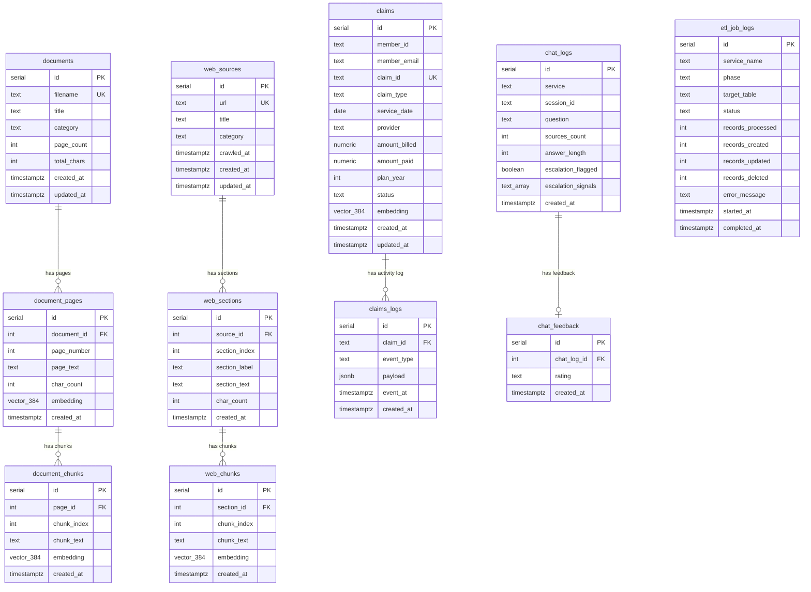

# Database Schema

The database has three independent content pipelines (documents, web content, claims) and two cross-cutting support tables (chat logging and ETL job history).

## Index Summary

| Table | Index type | Column(s) | Purpose |
|---|---|---|---|
| `document_pages` | HNSW cosine | `embedding` | Semantic page-level search |
| `document_chunks` | HNSW cosine | `embedding` | Semantic chunk-level search |
| `web_chunks` | HNSW cosine | `embedding` | Semantic web-content search |
| `claims` | HNSW cosine | `embedding` | Semantic claims search |
| `claims` | B-tree | `(member_id, service_date DESC)` | Member claim lookups |
| `claims` | B-tree | `member_email` | Email-based member resolution |
| `claims` | B-tree | `status` | Open/closed claim filtering |
| `chat_logs` | B-tree | `(service, created_at DESC)` | Analytics time-window queries |
| `chat_logs` | Partial B-tree | `created_at DESC WHERE escalation_flagged` | Fast escalation dashboard queries |
| `chat_feedback` | Unique B-tree | `chat_log_id` | Prevent duplicate ratings |

## Search Stored Procedures

| Procedure | Input | Searches |
|---|---|---|
| `sp_search_documents(embedding, top_k)` | 384d vector | `document_chunks` |
| `sp_search_documents_filtered(embedding, top_k, category)` | 384d vector + category | `document_chunks` WHERE category |
| `sp_search_pages(embedding, top_k)` | 384d vector | `document_pages` |
| `sp_search_web(embedding, top_k)` | 384d vector | `web_chunks` |
| `sp_search_all(embedding, top_k)` | 384d vector | `document_chunks` UNION ALL `web_chunks` |
| `sp_search_all_filtered(embedding, top_k, category)` | 384d vector + category | Both, filtered by category |
| `sp_analytics_summary(days)` | int | `chat_logs` LEFT JOIN `chat_feedback` |
