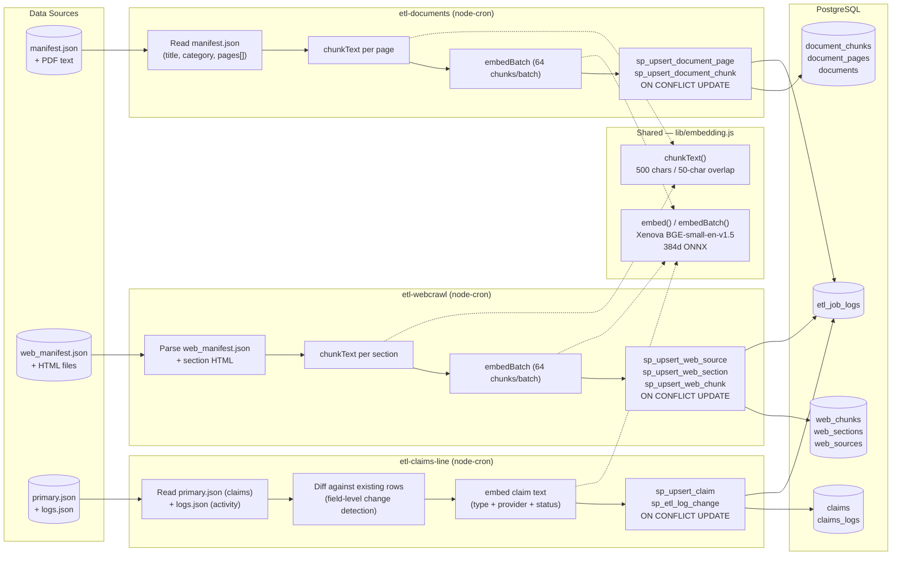
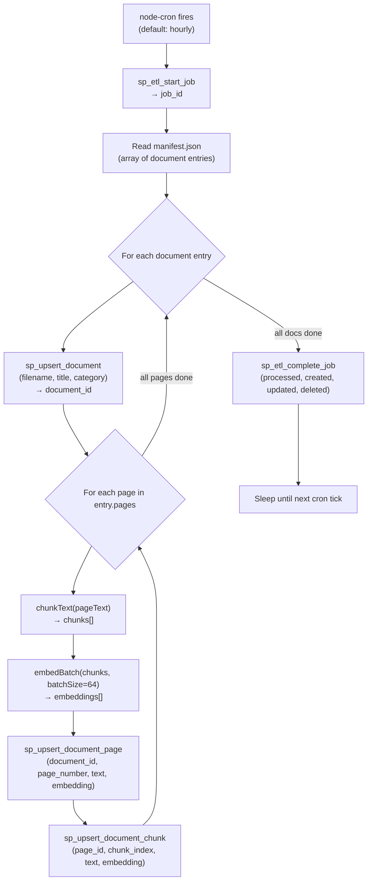
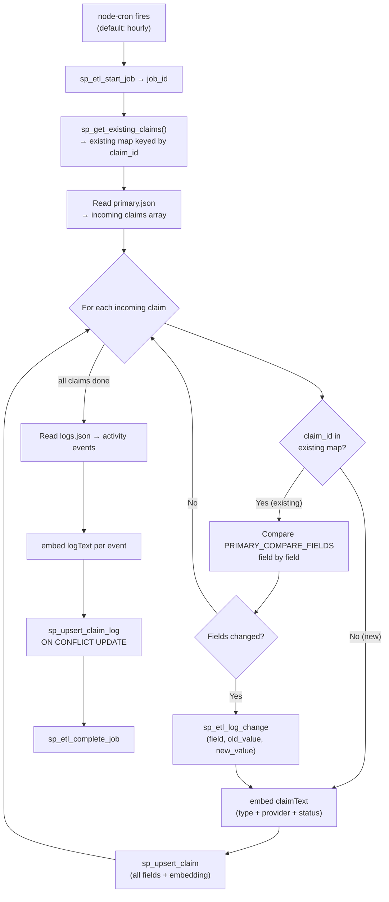

# ETL Pipelines

All three ETL services share the same structural pattern: read source data → chunk text → generate BGE embeddings → upsert into PostgreSQL via a stored procedure → log the job result. They differ in their source format and target schema.

## Overview

## Document ETL Detail

## Claims ETL Detail

The claims ETL has an additional field-level **change detection** step that the document and web ETLs omit. This lets it produce an audit log of exactly which fields changed for each claim.

