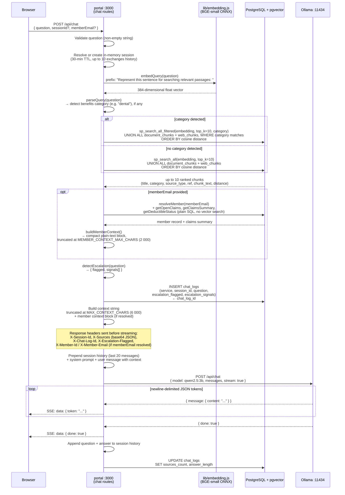
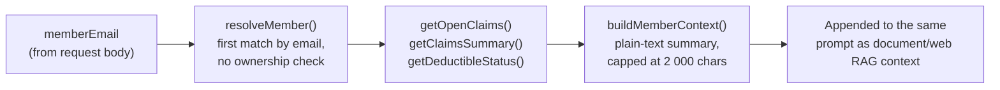
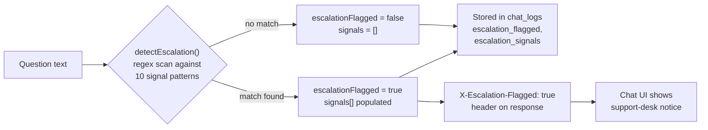
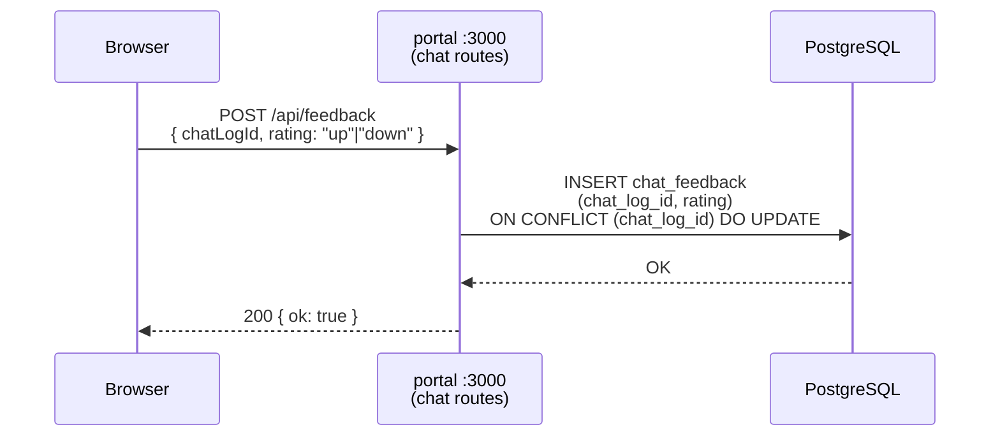
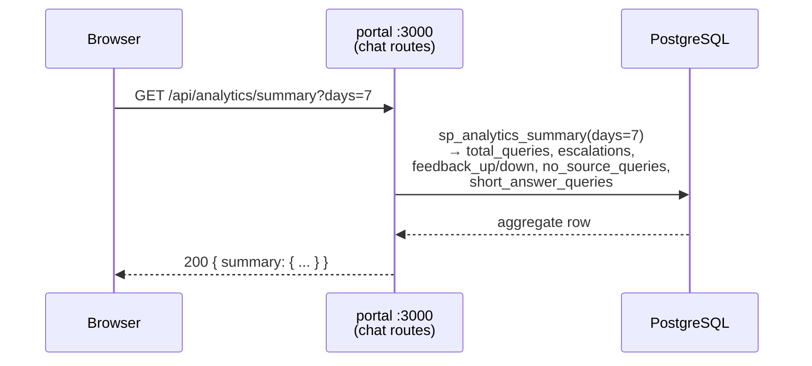

# RAG Chat Request Flow

Covers both the streaming endpoint (`POST /api/chat`) and the non-streaming endpoint (`POST /api/ask`), both served by the `portal` service's chat routes (`services/portal/src/routes/chat.js`). The member benefits bot (`POST /api/member/bot`) follows the same escalation-detection and logging steps but does not call Ollama.

Both chat endpoints accept an optional `memberEmail` field. When present, the request is personalized with that member's own claims record (see "Member Context" below); when absent, behavior is unchanged from a document/web-only assistant — anonymous chat is not gated in any way.

## Streaming Chat (`POST /api/chat`)

## Member Context (demo personalization)

`memberEmail` is supplied by the user via a "Chatting as" dropdown in the chat UI (populated from `GET /api/chat/members`) and is **not authenticated** — any caller can pass any member's email and receive that member's claims summary, open claims, and deductible status in the answer. This is an intentional demo/PoC shortcut, not a production-ready personalization model; see [SECURITY_REVIEW.md](../SECURITY_REVIEW.md) for the corresponding finding.

## Escalation Detection

Escalation runs synchronously before the Ollama call. If triggered, the `X-Escalation-Flagged: true` header is included in the response and the chat UI displays a support-desk notice.

## Feedback Loop (`POST /api/feedback`)

## Analytics Summary (`GET /api/analytics/summary`)

