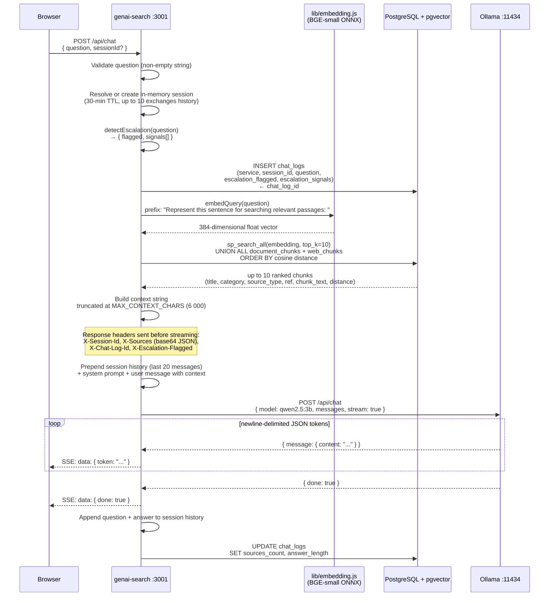
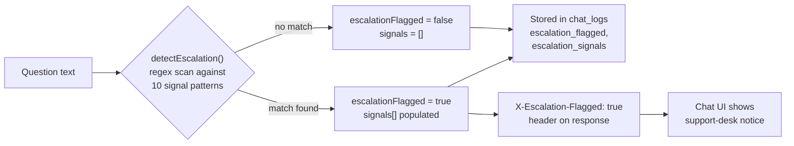
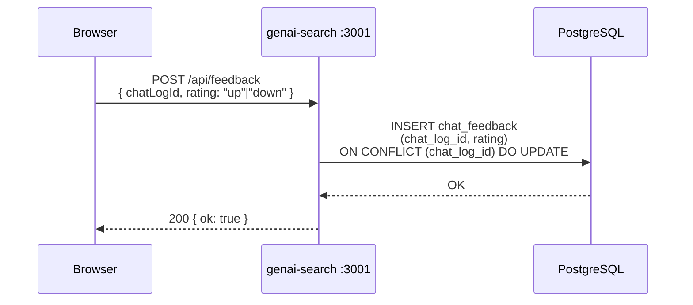
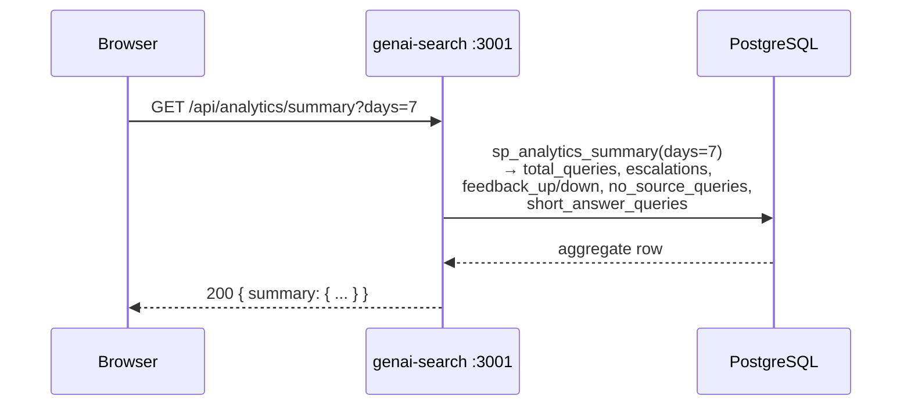

# RAG Chat Request Flow

Covers both the streaming endpoint (`POST /api/chat`) and the non-streaming endpoint (`POST /api/ask`). The member benefits bot (`POST /api/bot`) follows the same escalation-detection and logging steps but does not call Ollama.

## Streaming Chat (`POST /api/chat`)

## Escalation Detection

Escalation runs synchronously before the Ollama call. If triggered, the `X-Escalation-Flagged: true` header is included in the response and the chat UI displays a support-desk notice.

## Feedback Loop (`POST /api/feedback`)

## Analytics Summary (`GET /api/analytics/summary`)

