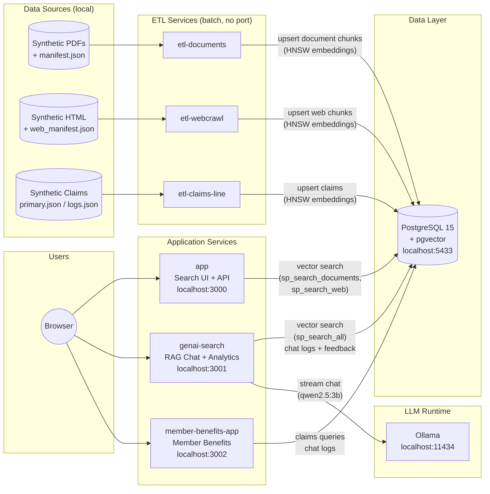
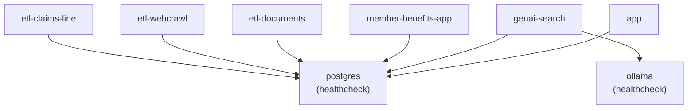

# System Architecture

All services run locally under Docker Compose. The three ETL containers are short-lived batch jobs; the five long-running services (PostgreSQL, Ollama, and the three application servers) stay up after `npm run setup`.

## Port Reference

| Container | Host Port | Notes |
|---|---|---|
| `postgres` | `5433` | Maps to container port `5432` |
| `app` | `3000` | Search UI served at `/`; Admin UI at `/admin.html` |
| `genai-search` | `3001` | Chat UI at `/`; Analytics dashboard at `/analytics.html` |
| `member-benefits-app` | `3002` | Member UI at `/`; all `/api/*` routes require `x-api-key` |
| `ollama` | `11434` | Internal; used only by `genai-search` |
| `etl-documents` | — | Batch job; exits after each cron run |
| `etl-webcrawl` | — | Batch job; exits after each cron run |
| `etl-claims-line` | — | Batch job; exits after each cron run |

## Service Dependencies

