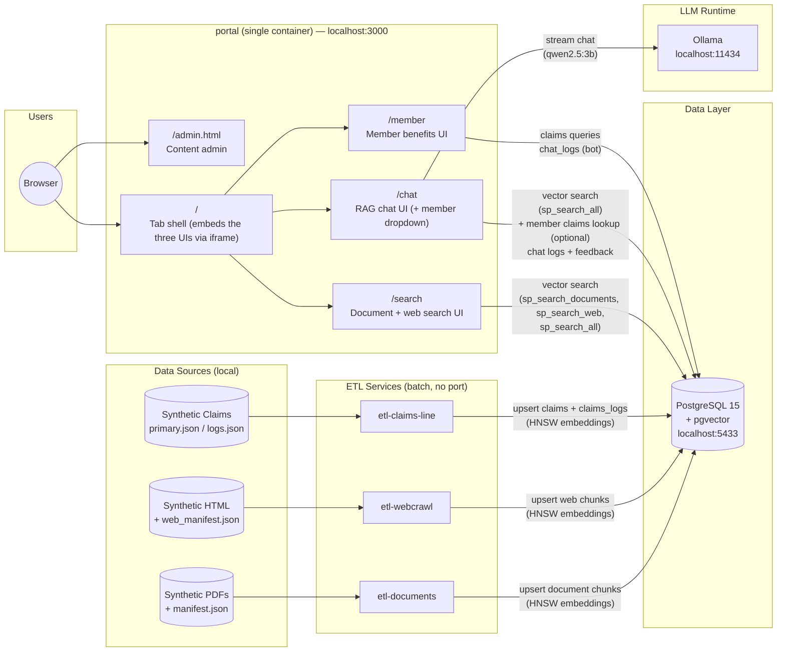
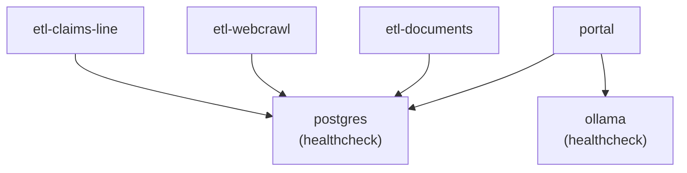

# System Architecture

All services run locally under Docker Compose. The three ETL containers are short-lived batch jobs. Search, RAG chat, and the member benefits assistant are unified into a single `portal` service/container; PostgreSQL and Ollama are the only other long-running containers.

## Port Reference

| Container | Host Port | Notes |
|---|---|---|
| `postgres` | `5433` (`${POSTGRES_HOST_PORT}`) | Maps to container port `5432` |
| `portal` | `3000` (`${PORTAL_HOST_PORT}`) | Single container serving all three UIs and their APIs — see paths below |
| `ollama` | `11434` (`${OLLAMA_HOST_PORT}`) | Internal; used only by the chat routes in `portal` |
| `etl-documents` | — | Batch job; exits after each cron run |
| `etl-webcrawl` | — | Batch job; exits after each cron run |
| `etl-claims-line` | — | Batch job; exits after each cron run |

All three host ports are parameterized via environment variables (defaulting to the values above) so a second `portal` stack can be run side-by-side on alternate ports for review/demo purposes without editing the Compose files.

### `portal` paths

| Path | Purpose |
|---|---|
| `/` | Unified tab shell — embeds `/search`, `/chat`, and `/member` via same-origin iframes |
| `/search` | Document + web search UI (pure vector search, no personalization) |
| `/chat` | RAG chat UI; includes a "Chatting as" member dropdown for demo personalization |
| `/member` | Member benefits UI (claims, plan details, deductible, document generation, rule-based bot) |
| `/admin.html` | Content admin (documents + web sources), gated by `X-Admin-Key` when `ADMIN_KEY` is set |
| `/api/*` | Search + admin API |
| `/api/chat`, `/api/ask`, `/api/feedback`, `/api/analytics/*`, `/api/chat/members` | Chat API |
| `/api/member/*` | Member-scoped API, gated by `X-API-Key` when `API_KEY` is set and by member resolution |

## Service Dependencies

